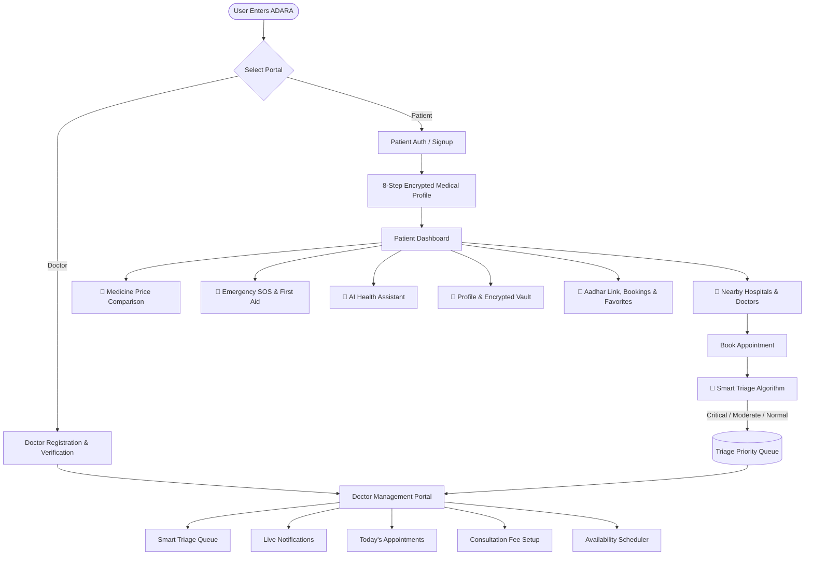

# 🏥 ADARA — A Way to Care

<div align="center">


### **A Unified, Next-Generation Digital Healthcare & Smart Triage Platform**

[](https://developer.mozilla.org/en-US/docs/Web/HTML)
[](https://developer.mozilla.org/en-US/docs/Web/CSS)
[](https://developer.mozilla.org/en-US/docs/Web/JavaScript)
[](LICENSE)
[](https://github.com/arijits1221/health/pulls)

*ADARA bridges the gap between patients, medical practitioners, and emergency services through an intuitive, accessible, and privacy-conscious web interface.*

[Explore Features](#-core-features) • [Quick Start](#-getting-started) • [Architecture](#-system-architecture) • [Doctor Portal](#-doctor-portal-dashboard) • [Patient Portal](#-patient-portal)

</div>

---

## 📖 Table of Contents

- [Overview](#-overview)
- [Key Highlights](#-key-highlights)
- [Core Features](#-core-features)
  - [1. Role-Based Dual Portal (Patient & Doctor)](#1-role-based-dual-portal)
  - [2. 8-Step Encrypted Medical Profile Vault](#2-8-step-encrypted-medical-profile-vault)
  - [3. Smart Triage & Priority Queue Engine](#3-smart-triage--priority-queue-engine)
  - [4. Nearby Hospital Directory & Booking](#4-nearby-hospital-directory--booking)
  - [5. Multi-Platform Medicine Price Comparison](#5-multi-platform-medicine-price-comparison)
  - [6. Life-Saving Emergency SOS & First Aid Guide](#6-life-saving-emergency-sos--first-aid-guide)
  - [7. 24/7 AI Health Assistant (Chatbot)](#7-247-ai-health-assistant-chatbot)
  - [8. Digital ID & ABHA/Aadhar Integration](#8-digital-id--abhaaadhar-integration)
- [System Architecture](#-system-architecture)
- [Project Directory Structure](#-project-directory-structure)
- [Getting Started](#-getting-started)
- [Usage Guide & Workflow](#-usage-guide--workflow)
- [Security & Data Privacy](#-security--data-privacy)
- [Future Roadmap](#-future-roadmap)
- [Contributing](#-contributing)
- [License & Authors](#-license--authors)

---

## 🌟 Overview

**ADARA — A Way to Care** is an all-in-one healthcare management web application designed to streamline healthcare access. Whether a patient is experiencing a sudden medical emergency, searching for specialized hospital facilities, comparing generic prescription prices across quick-commerce delivery platforms, or managing chronic conditions, ADARA provides instant assistance.

For healthcare providers, ADARA offers an intelligent practice dashboard equipped with an automated **Smart Triage Priority Engine**, ensuring critical medical emergencies are prioritized over routine consultations.

---

## ✨ Key Highlights

- ⚡ **Zero Dependencies / No Build Step Required**: Built purely with vanilla modern web standards (Semantic HTML5, CSS3 Custom Properties, and ES6+ JavaScript Object-Oriented architecture). Runs natively in any browser.
- 🚨 **Emergency-Ready**: High-visibility SOS alert dispatching location and notifying emergency services (102 Ambulance, 100 Police, 101 Fire).
- 🧠 **Algorithmic Smart Triage**: Automatically categorizes appointments into `CRITICAL`, `MODERATE`, or `NORMAL` based on patient symptoms and vitals.
- 🔒 **Encrypted Medical Profile Vault**: Password-protected patient history safeguarding blood groups, allergies, medications, and surgical history.
- 🌓 **Adaptive Theme**: Built-in Dark Mode / Light Mode with state persistence across browser sessions.
- 📱 **Responsive Mobile-First UI**: Optimized for smartphones, tablets, and desktop workstations with native-feeling app navigation.

---

## 🚀 Core Features

### 1. Role-Based Dual Portal
ADARA provides tailored experiences based on user persona right from the landing screen:
- **Patient Portal**: Comprehensive health tracking, hospital search, medicine shopping, doctor booking, and SOS safety.
- **Doctor Portal**: Medical credential verification (license, qualifications, specialty), schedule management, triage queue, and fee customization.

---

### 2. 8-Step Encrypted Medical Profile Vault
New patients complete an interactive onboarding process that organizes critical health metrics:
1. **Blood Group**: Direct selector for ABO/Rh blood types (`O+`, `O-`, `A+`, `A-`, `B+`, `B-`, `AB+`, `AB-`).
2. **Allergy Registry**: Tracks reactions to drugs (Penicillin, Aspirin, Ibuprofen) and environmental factors (Latex, Shellfish, Peanuts).
3. **Chronic Conditions**: Manages long-term records for Diabetes, Hypertension, Asthma, Heart Disease, and Thyroid disorders.
4. **Current Medications**: Documents daily dosages and active prescriptions.
5. **Surgical History**: Tracks previous surgical interventions, implants, and dates.
6. **Vitals & BMI Calculator**: Real-time height/weight calculation showing automatic BMI categorizations (Underweight, Normal, Overweight, Obese).
7. **Emergency Contacts**: Stores dual primary and secondary contact details.
8. **Organ Donor Registration**: Formal consent and organ donation preference declaration.

> 🔐 **Privacy Vault**: Medical records are locked behind user password verification in the profile view to prevent unauthorized exposure.

---

### 3. Smart Triage & Priority Queue Engine
Unlike standard appointment booking systems that work on a static first-come, first-served basis, ADARA implements a **Smart Medical Triage System**:
- Scans symptom inputs for high-risk flags (*chest pain, severe breathing difficulty, acute trauma, uncontrolled bleeding*).
- Immediately classifies patient status:
  - 🔴 **CRITICAL**: Immediate dispatch, top of queue priority, zero-delay doctor alert.
  - 🟡 **MODERATE**: Expedited priority following critical cases.
  - 🟢 **NORMAL**: Standard time-slot scheduling.
- **Token System & Dynamic Wait Times**: Live queue token generator with automated waiting time predictions based on average consultation durations.

---

### 4. Nearby Hospital Directory & Booking
Browse and filter top-tier verified healthcare institutions:
- **Comprehensive Profiles**: Apollo Hospitals, Max Healthcare, Fortis Healthcare, Sir Ganga Ram Hospital, Delhi Heart Institute, and Indraprastha Apollo.
- **Key Metrics**: Verified ratings, total bed capacity, distance in km, fee ranges, and direct contact numbers.
- **Facility Infrastructure**: Real-time indicators for 24/7 Emergency, ICU units, OPD operation, Operation Theatres (OTs), Cath Labs, and Pathology Diagnostics.
- **Doctor Rosters**: Direct booking with specialized physicians, cardiologists, orthopedic surgeons, pediatricians, and neurologists.
- **Favorites / Bookmarks**: Save preferred hospitals and practitioners for one-click access.

---

### 5. Multi-Platform Medicine Price Comparison
Integrated pharmacy search engine providing instant price visibility:
- **Fast-Delivery Platforms**: Compares live pricing and estimated delivery speeds across platforms including **Zepto** (10 mins), **Blinkit** (12 mins), **Instamart** (15 mins), **Apollo 24/7**, and **Pharmeasy**.
- **Alternative Medicine Suggestions**: Recommends generic equivalents (e.g., Crocin / Dolo / Paracetamol for Aspirin) to reduce out-of-pocket costs.
- **Direct Order Links**: Quick-cart checkout redirect.

---

### 6. Life-Saving Emergency SOS & First Aid Guide
- **One-Tap SOS Trigger**: Prominently accessible red emergency button that alerts emergency contacts, transmits current GPS coordinates, and dials designated dispatch services.
- **Customizable Emergency Numbers**: Pre-configured with national emergency hotlines (102, 100, 101) with user-editable options.
- **Interactive First Aid Guides**: Immediate emergency step-by-step procedures with visual guidelines for:
  - 🫁 Choking (Heimlich Maneuver)
  - 💓 Cardiac Arrest (CPR protocols)
  - 🩸 Severe Bleeding & Tourniquet application
  - 🔥 Thermal & Chemical Burns
  - 🦴 Fractures & Immobilization
  - ☠️ Ingestion & Poisoning Management

---

### 7. 24/7 AI Health Assistant (Chatbot)
An interactive medical guide built directly into the patient bottom bar:
- **Symptom Checker**: Diagnostic guidance based on duration, severity, and localized discomfort.
- **Quick-Prompt Shortcuts**: Instant cards for *Symptoms*, *Medicines*, *Diseases*, and *Preventive Tips*.
- **Home Care & Precautions**: Safe self-care protocols for mild ailments (fever, migraine, common cold, coughing).
- **Escalation Advice**: Clear red-flag warning triggers specifying when to seek immediate in-person emergency care.

---

### 8. Digital ID & ABHA/Aadhar Integration
- Seamless patient identity verification through **12-digit Aadhar / ABHA ID** linking.
- Full consent-driven verification workflow with status badges and unlinking management.
- Lays the foundation for unified national digital health record compliance.

---

### 👨‍⚕️ Doctor Portal Dashboard
Healthcare professionals access a dedicated suite of practice management tools:
- **Live Notifications Feed**: Real-time alerts as soon as patients book or update consults.
- **Smart Queue Manager**: View arriving patients ranked automatically by triage severity level with calculated waiting intervals.
- **Today's Appointments**: Detailed calendar agenda of booked slots.
- **Patient History Records**: Lookup past consultations, prescriptions, and medical records.
- **Weekly Schedule Customizer**: Configure working hours independently for each day (Monday – Saturday).
- **Tiered Consultation Fee Setting**: Customize separate rates for *Video Consultation*, *Chat Consultation*, and *In-Clinic Visits*.

---

## 🏗️ System Architecture



---

## 📁 Project Directory Structure

```text
health/
├── css/
│   └── style.css            # 3,190+ lines: Design tokens, dark mode, responsive layout, glassmorphism
├── js/
│   └── app.js               # 2,220+ lines: Object-Oriented App core, triage algorithm, mock datasets
├── index.html               # 1,200+ lines: Semantic single-page structure with all views & modals
├── logo.png                 # Primary application branding logo
├── logo.png.jpeg            # High-resolution brand asset
└── README.md                # Project documentation
```

---

## 💻 Tech Stack

| Domain | Technology | Description |
| :--- | :--- | :--- |
| **Markup** | HTML5 | Semantic structure with ARIA accessibility labels and mobile meta viewports |
| **Styling** | CSS3 (Vanilla) | Custom CSS variables, Flexbox, CSS Grid, Glassmorphic effects, keyframe animations |
| **Scripting** | JavaScript (ES6+) | Single-Class OOP Architecture (`App`), event delegation, asynchronous simulation |
| **Icons** | Font Awesome 6.4 | Vector iconography for medical specialties, emergency symbols, and navigational elements |
| **State Storage** | HTML5 Web Storage | `localStorage` persistence for profiles, authentication sessions, queues, and bookings |
| **Typography** | Segoe UI, Roboto | Modern clean typographic scale optimized for high-density medical information display |

---

## ⚡ Getting Started

### Prerequisites
ADARA is built with zero external dependencies, package managers, or compilation steps. All you need is a modern web browser:
- Google Chrome (recommended)
- Mozilla Firefox
- Microsoft Edge
- Apple Safari

### Local Setup Instructions

1. **Clone the Repository**:
   ```bash
   git clone https://github.com/arijits1221/health.git
   cd health
   ```

2. **Launch the Application**:
   - **Option A (Direct Open)**: Double-click `index.html` or open it with your web browser.
   - **Option B (VS Code Live Server)**: Right-click `index.html` and select **"Open with Live Server"**.
   - **Option C (Python HTTP Server)**:
     ```bash
     # Python 3
     python -m http.server 3000
     ```
     Then navigate to `http://localhost:3000` in your browser.
   - **Option D (Node npx serve)**:
     ```bash
     npx serve .
     ```

---

## 📱 Usage Guide & Workflow

### Testing as a Patient
1. On the landing page, click **"Continue as Patient"**.
2. Select **"Sign Up"** and fill in your basic details (Name, Age, Gender, DOB, City, Phone, and Password).
3. Complete the **8-step Medical Profile** (select blood group, chronic conditions, allergy tags, etc.) or skip forward.
4. On the **Home** tab, explore nearby hospitals and click **"Book Appointment"** on any doctor.
5. In the booking modal, select symptoms such as *"Chest Pain"* or set Severity to *"Critical"* to witness the **Smart Triage Engine** assign high priority.
6. Check the **Pharmacy** tab and search for `aspirin`, `paracetamol`, or `crocin` to review live platform pricing.
7. Tap the **Emergency SOS** tab to review immediate first aid procedures and emergency protocols.

### Testing as a Doctor
1. On the landing page, choose **"Continue as Doctor"**.
2. Register with your medical license number, specialty (e.g., *Cardiology*), hospital affiliation, and experience.
3. Access the **Doctor Dashboard**:
   - Check the **Queue** tab to monitor patients categorized with triage priority tags.
   - Review the **Notifications** tab for real-time booking alerts.
   - Configure weekly consultation availability and set rates for Video/In-Clinic visits.

---

## 🛡️ Security & Data Privacy

- **Client-Side Encrypted Vault**: Sensitive medical indicators (allergies, donor status, surgical history) require user password authorization before being revealed in the UI.
- **Isolated Local Sessions**: Data stored in browser `localStorage` avoids third-party tracking cookies.
- **Explicit Aadhar Consent**: Digital ID linking requires an explicit user consent checkbox before processing.
- **Production Readiness Note**: When connecting to a production remote backend, ensure:
  - Transport Layer Security (HTTPS) encryption.
  - End-to-end encryption for stored Protected Health Information (PHI).
  - Adherence to HIPAA / GDPR / ABDM (Ayushman Bharat Digital Mission) compliance guidelines.

---

## 🗺️ Future Roadmap

- [ ] **Tele-Consultation**: Integrated WebRTC peer-to-peer video calling for remote doctor consultations.
- [ ] **Payment Gateway**: Integration with Razorpay / Stripe for advance consultation fee payments.
- [ ] **Official ABHA API**: Live verification and health record fetch via National Health Authority (NHA) APIs.
- [ ] **Prescription OCR & Scanner**: Optical character recognition to automatically extract medication names from uploaded prescription photos.
- [ ] **PWA & Offline Mode**: Progressive Web App manifest and Service Worker caching for offline emergency first-aid access.
- [ ] **Multi-Language Support**: Localization in Hindi, Spanish, and other regional languages.

---

## 🤝 Contributing

Contributions, feature suggestions, and bug fixes are warmly welcome!

1. **Fork the Repository**
2. **Create a Feature Branch**:
   ```bash
   git checkout -b feature/AmazingHealthcareFeature
   ```
3. **Commit your Changes**:
   ```bash
   git commit -m "Add AmazingHealthcareFeature"
   ```
4. **Push to the Branch**:
   ```bash
   git push origin feature/AmazingHealthcareFeature
   ```
5. **Open a Pull Request**

---

## 📄 License & Authors

This project is licensed under the **MIT License** — see the [LICENSE](LICENSE) file for details.

Developed with care by **[Arijit](https://github.com/arijits1221)** and contributors.

<div align="center">
  <sub>ADARA — A Way to Care • Making Quality Healthcare Accessible for Everyone ❤️</sub>
</div>
